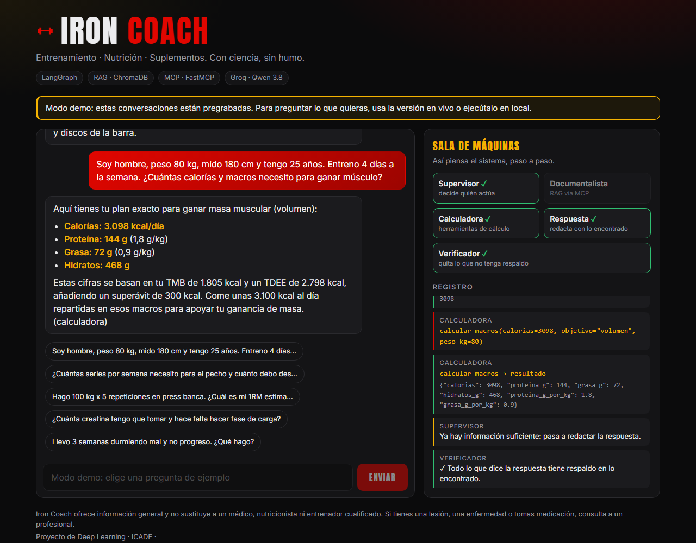
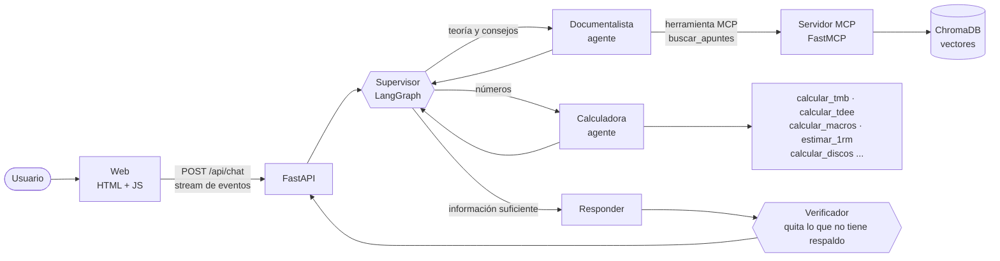

# 🏋️ Iron Coach

**Chatbot de culturismo con agentes de IA.** Responde dudas de entrenamiento, nutrición y suplementación con información de fuentes citadas, y hace los cálculos (calorías, macros, 1RM, discos de la barra) con herramientas en lugar de "inventarse" los números.



> Proyecto de **Deep Learning (ICADE)**: agentes con **LangChain y LangGraph**, **RAG con ChromaDB** y **servidor MCP con FastMCP**.

| | |
|---|---|
| 🌐 **Demo (sin instalar nada)** | <https://iherreroo.github.io/iron-coach/> |
| 🔴 **Chat con el modelo real** | Se ejecuta en local ([instrucciones](#-ejecutarlo-en-local)); no hay instancia pública gratuita, ver [Despliegue](#-despliegue-versión-en-vivo) |

---

## ✨ ¿Qué lo hace especial?

- **Sala de máquinas.** La web no solo muestra la respuesta: enseña en directo qué agente actúa, qué herramienta ejecuta (con sus argumentos) y qué ficheros consulta el RAG. Se ve *cómo* razona el sistema.
- **Los números no los inventa el modelo.** TMB, TDEE, calorías, macros, 1RM y discos se calculan con funciones Python probadas con tests.
- **Responde con fuentes y sin inventar.** El conocimiento sale de documentos que citan sus fuentes (posición de la ISSN, revisiones sobre volumen de entrenamiento...), la respuesta indica el fichero en el que se basa y un nodo verificador elimina lo que no tenga respaldo.
- **Gratis de punta a punta.** LLM en el plan gratuito de Groq (`qwen3.8-27b` + `gpt-oss-20b`; cambiables con `MODELO` y `MODELO_LIGERO`) y embeddings locales. Sin tarjeta.

## 🧠 Arquitectura



**Flujo de una pregunta**

1. El **supervisor** (con salida estructurada, `with_structured_output`) decide quién actúa: `documentalista`, `calculadora` o `FIN`.
2. El especialista trabaja (un agente `create_agent` con su propio *system prompt* y herramientas) y devuelve un hallazgo al estado compartido.
3. El supervisor vuelve a decidir (hasta `MAX_PASOS` para evitar bucles). Una pregunta mixta, como *"calcula mis macros y dime si necesito creatina"*, encadena a los dos.
4. El nodo **responder** redacta un borrador usando solo lo encontrado y citando las fuentes.
5. El nodo **verificar** contrasta el borrador con lo que dijeron los especialistas y **elimina cualquier dato sin respaldo** (una dosis, un suplemento o una cifra que el modelo "sabe" pero que no está en los documentos). Lo que quita aparece en el panel de la web.

> **Por qué hay verificador.** En las pruebas, el modelo llegó a recomendar melatonina y magnesio con dosis que no estaban en ningún documento. Afinar los *prompts* no bastó (los LLM no son deterministas ni a temperatura 0), así que se añadió una comprobación estructural al grafo. El enrutado también está protegido: un especialista no puede repetirse y, si el supervisor intenta terminar sin consultar a nadie, se le pide una segunda opinión.

| Pieza | Tecnología | Dónde |
|---|---|---|
| Orquestación | LangGraph (`StateGraph`, arista condicional) | [`app/grafo.py`](app/grafo.py) |
| Agentes | LangChain `create_agent` | [`app/agentes.py`](app/agentes.py) |
| RAG: ingesta | `RecursiveCharacterTextSplitter` + ChromaDB | [`app/ingesta.py`](app/ingesta.py) |
| Servidor MCP | FastMCP (`@servidor.tool`) | [`app/servidor_mcp.py`](app/servidor_mcp.py) |
| Cliente MCP | `langchain-mcp-adapters` (sesión persistente) | [`server.py`](server.py) |
| Herramientas de cálculo | `@tool` de LangChain | [`app/herramientas.py`](app/herramientas.py) |
| Embeddings | fastembed (modelo multilingüe local) | [`app/config.py`](app/config.py) |
| LLM | qwen3.8-27b y gpt-oss-20b en Groq (gratis) | [`app/config.py`](app/config.py) |
| API y web | FastAPI + HTML/CSS/JS sin framework | [`server.py`](server.py), [`web/`](web/) |

## 🎬 Demo

La carpeta [`web/`](web/) funciona también sin servidor: si no encuentra la API, entra en **modo demo** y reproduce cinco conversaciones, con el mismo panel de trazas (qué agente actúa, qué herramienta se ejecuta, qué ficheros se consultan y qué quita el verificador).

> ℹ️ Las conversaciones de [`web/demo.json`](web/demo.json) son **grabaciones reales** del sistema, no texto escrito a mano: las genera [`grabar_demo.py`](grabar_demo.py) enviando cada pregunta al servidor y guardando todos los eventos tal cual los emitió. Es lo mismo que el servidor usa como respuestas ya cacheadas para las sugerencias de la web, así que estas cinco preguntas responden al instante y sin gastar cuota de Groq.

Se publica automáticamente con GitHub Actions ([`.github/workflows/pages.yml`](.github/workflows/pages.yml)).

## 🚀 Ejecutarlo en local

Necesitas Python 3.10 o superior y una **clave gratuita de Groq** (sin tarjeta): <https://console.groq.com/keys>.

```bash
git clone https://github.com/iherreroo/iron-coach.git
cd iron-coach

python -m venv .venv
# Windows: .venv\Scripts\activate      Linux/Mac: source .venv/bin/activate
pip install -r requirements.txt

cp .env.example .env        # y pega tu GROQ_API_KEY dentro de .env
python -m app.ingesta       # crea la base vectorial (la 1.ª vez descarga ~220 MB)
python server.py            # abre http://localhost:8000
```

Con [uv](https://docs.astral.sh/uv/) es aún más rápido: `uv venv && uv pip install -r requirements.txt`.

### Otras formas de usarlo

```bash
python main.py "Peso 80 kg, mido 180 cm, tengo 25 años y entreno 4 días. ¿Calorías para volumen?"
python probar_mcp.py "¿Cuánta proteína necesito al día?"   # prueba el servidor MCP sin LLM
python -m unittest discover -s tests                        # tests de las fórmulas
```

El servidor MCP también se puede usar desde otras aplicaciones, por ejemplo **Claude Desktop o Claude Code**, porque `python -m app.servidor_mcp` habla MCP por `stdio`.

## ☁️ Despliegue (versión en vivo)

El proyecto incluye un [`Dockerfile`](Dockerfile) (puerto 7860, compatible con **Hugging Face Spaces**). La ingesta se ejecuta durante el *build*, así que el contenedor arranca con la base vectorial lista. En cualquier plataforma que ejecute Docker, la única variable obligatoria es el secreto **`GROQ_API_KEY`**; nunca debe estar en el repositorio (`.env` está en `.gitignore`).

**Requisitos reales de hosting (medidos):** la app ocupa unos 280 MB en reposo y unos **900 MB** tras la primera pregunta libre, porque el servidor MCP carga entonces el modelo de embeddings. Por eso los planes gratuitos de 512 MB no son suficientes.

**Situación actual de la versión en vivo:** a fecha de noviembre de 2026, Hugging Face solo permite crear Spaces *Docker* con una suscripción PRO (los Spaces estáticos siguen siendo gratuitos, pero no ejecutan Python). Por eso este repositorio publica gratis la **demo estática** en GitHub Pages y el chat con el modelo real se ejecuta en local. Si dispones de un hosting con ≥1 GB de RAM, basta con construir la imagen y definir `GROQ_API_KEY`.

**Protecciones de la demo en vivo**: límite de preguntas por IP (`MAX_PETICIONES`, 20 cada 10 min), las preguntas libres se atienden de una en una y mensajes de hasta 600 caracteres, para no agotar el plan gratuito de Groq.

## 📁 Estructura

```
iron-coach/
├── conocimiento/            # documentos del RAG (Markdown, con fuentes)
├── app/
│   ├── config.py            # rutas, LLM (Groq) y embeddings locales
│   ├── ingesta.py           # documentos -> fragmentos -> ChromaDB
│   ├── servidor_mcp.py      # servidor MCP (FastMCP): buscar_apuntes
│   ├── herramientas.py      # herramientas de la calculadora
│   ├── agentes.py           # documentalista y calculadora
│   └── grafo.py             # supervisor + grafo LangGraph
├── server.py                # API FastAPI (stream NDJSON) + sirve web/
├── web/                     # frontend (también funciona como demo estática)
├── tests/                   # tests de las fórmulas
├── main.py                  # uso por consola
├── probar_mcp.py            # prueba del servidor MCP sin agentes
├── grabar_demo.py           # regraba web/demo.json con conversaciones reales
├── Dockerfile               # despliegue
└── requirements.txt
```

## 📚 Base de conocimiento

Cinco documentos en [`conocimiento/`](conocimiento/): entrenamiento para hipertrofia, nutrición y macros, suplementos, recuperación y sueño, y ejercicios y rutinas. Están redactados con mis propias palabras a partir de fuentes públicas, y cada uno termina con sus referencias. Entre ellas:

- ISSN, *Position Stand: protein and exercise* (Jäger et al., 2017): <https://pubmed.ncbi.nlm.nih.gov/28642676/>
- ISSN, posición sobre proteína (Campbell et al., 2007): <https://pubmed.ncbi.nlm.nih.gov/17908291/>
- Revisiones divulgativas sobre volumen semanal: [Intramed](https://www.intramed.net/content/variables-del-entrenamiento-de-fuerza) y [Vitónica](https://www.vitonica.com/entrenamiento/volumen-entrenamiento-cuantas-series-semanales-hacer-cada-grupo-muscular-para-maximizar-hipertrofia)
- Sports Science Exchange, seguridad y eficacia de la suplementación: [GSSI](https://www.gssiweb.org/docs/librariesprovider9/sse-pdfs/186_seguridad-eficacia-de-suplementacion.pdf?sfvrsn=2)

Algunas secciones (ritmos semanales de peso, RIR, estructura de rutinas, técnica) resumen criterios habituales de la práctica y no una única fuente; los documentos lo indican.

Para añadir conocimiento, crea un `.md` en `conocimiento/` y vuelve a ejecutar `python -m app.ingesta`. Los identificadores fijos evitan duplicados.

## ⚠️ Limitaciones

- **No es consejo médico.** Iron Coach no sustituye a un médico, nutricionista ni entrenador. No recomienda esteroides ni sustancias dopantes.
- La base de conocimiento es pequeña (5 documentos): si algo no está, el sistema debe decirlo en lugar de inventarlo, pero un LLM puede equivocarse.
- Las ecuaciones (Mifflin-St Jeor, Epley) son estimaciones con un margen de error.
- **Límites del plan gratuito de Groq.** Cada modelo tiene su propio cupo (en las pruebas: 8.000 tokens por minuto y 200.000 al día) y una pregunta cuesta unos miles de tokens. Si se agota, la web lo indica. Según lo observado en las cabeceras de respuesta de Groq (pueden cambiar): el cupo por minuto se recupera en segundos y el diario funciona como una ventana móvil, no como un reinicio a una hora fija; tras agotarlo, Groq indicó esperar unos minutos y la cuota se va liberando poco a poco. Para que la demo no dependa de la cuota, las preguntas sugeridas se sirven desde la caché, y el servidor limita las preguntas libres por IP.
- **Cambio de modelo.** El proyecto empezó con Llama 3.3 70B, pero Groq lo retiró de su plan gratuito. Hoy usa `qwen3.8-27b` (supervisor, agentes y respuesta) y `gpt-oss-20b` (verificador). Se cambian con `MODELO` y `MODELO_LIGERO` en `.env`.
- Los modelos gratuitos fallan de vez en cuando al generar una llamada a herramienta: el grafo reintenta automáticamente y, si el verificador no puede completarse, lo indica en lugar de decir que todo está respaldado.

## 🔧 Nota técnica (Windows)

En algunos equipos Windows, `onnxruntime` 1.32 se cae al cargarse y ChromaDB falla si `onnxruntime` ya está cargado antes de crear su cliente. Por eso `requirements.txt` fija `onnxruntime<1.22` y los embeddings se cargan de forma diferida en [`app/config.py`](app/config.py).

---

Hecho con LangGraph, LangChain, ChromaDB, FastMCP, FastAPI y Groq.
